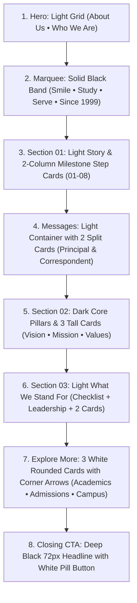

# Reference Specification: Heedhive Services & Header Audit

> Measured from live DevTools inspection of `https://heedhive.in/services` and `https://heedhive.in` at 1440px and 390px viewports, verified against user screenshots.

---

## 1. Typography & Loaded Fonts

- **Primary Font Family**: `Montserrat, -apple-system, BlinkMacSystemFont, 'Segoe UI', Roboto, sans-serif`
  - Loaded via Google Fonts: `family=Montserrat:ital,wght@0,300;0,400;0,500;0,600;0,700;0,800;1,400;1,600&display=swap`
  - **Headings (H1, H2)**: `Montserrat`, weights `600` / `700`, tight letter-spacing (`-0.02em` to `-0.03em`).
  - **Section Titles (H3, H4)**: `Montserrat`, weights `600` / `700`.
  - **Body / Paragraph**: `Montserrat` / `Inter`, weight `400`, size `16px` – `20px`, line-height `1.5` – `1.7`, color `rgb(82, 82, 82)` / `#525252`.
  - **Nav Links**: `Montserrat`, weight `500`, size `16px` (`1rem`), color `rgb(255, 255, 255)`.
  - **CTA Button**: `Montserrat`, weight `500` / `600`, size `14px` (`0.875rem`), color `rgb(255, 255, 255)`.

---

## 2. Global Header Specification (Desktop 1440px & Mobile 390px)

| Element | Reference Measured Value | Proposed React Value | Tokens Mapping |
| :--- | :--- | :--- | :--- |
| **Header Bar Height** | ~72px total row height | `74px` | `--header-height: 74px` |
| **Header Background** | `rgba(255, 255, 255, 0.92)` + `backdrop-filter: blur(14px)` | Same + `.bg-grid` behind | `var(--color-white-a94)` |
| **Header Page Padding** | `32px` left/right (`max-width: 1320px`) | `32px` left/right | `--container-padding: 32px` |
| **Logo Lockup** | Crest badge (52px tile) + Title text | Crest tile + "SHSVM" + tagline | `--radius-tile: 12px` |
| **Nav Container Tag** | Rounded Rectangle (`DIV` / `NAV`) | `NAV.header-nav-box` | `--radius-nav-box: 14px` |
| **Nav Container Height**| `38px` (bounds y=29 to y=65, padding 6px 32px) | `42px` (accessible fit) | `--nav-container-height: 42px` |
| **Nav Container Radius**| **12px – 14px** (NOT a pill!) | `14px` | `--radius-nav-box: 14px` |
| **Nav Container Bg** | `rgb(0, 0, 0)` (#000000) | `#000000` | `var(--color-black)` |
| **Nav Container Border**| `1px solid rgba(255, 255, 255, 0.2)` | `1px solid rgba(255, 255, 255, 0.18)` | `--color-white-a18` |
| **Nav Links (Desktop)**| `Home | About | Academics | Admissions | Contact` | 5 core links | `var(--font-heading)` |
| **Nav Link Font** | `Montserrat`, `16px`, weight `500` | `Montserrat`, `15px`, weight `500` | `--font-nav: 'Montserrat'` |
| **Nav Link Spacing** | `gap: 28px – 32px`, `padding: 0 4px` | `padding: 4px 14px` | Flex item layout |
| **Nav Dividers** | 1px wide, **24px height** (~63% of box height) | `width: 1px; height: 22px;` | `--color-nav-divider: #9CA3AF` |
| **Nav Divider Color** | `rgb(156, 163, 175)` (`#9CA3AF`) | `rgba(255, 255, 255, 0.25)` | Light gray / translucent |
| **CTA Button Shape** | **Fully rounded Pill** (`border-radius: 9999px`) | Pill (`border-radius: 9999px`) | `var(--radius-pill)` |
| **CTA Button Size** | `height: 32px – 36px`, `padding: 6px 18px` | `height: 38px`, `padding: 8px 20px` | Matches reference pill |
| **CTA Button Text** | "Apply for Admission" (`14px`, weight `500`) | `14px`, weight `600` | `var(--color-white)` on black |
| **Hamburger Icon** | 2 horizontal bars (width 18px, height 2px, gap 6px)| 2 lines `=` (width 20px, height 2px)| Visible desktop & mobile |

### Nav & Button Interaction States
- **Nav Link Hover**: `color: #FFFFFF; opacity: 1; transform: translateY(-1px);`
- **Nav Link Active**: `color: var(--color-accent-on-dark);` (or white with bright underline dot).
- **CTA Button Hover**: `background-color: var(--color-gray-dark); transform: translateY(-1px); box-shadow: 0 4px 12px rgba(0,0,0,0.2);`
- **Hamburger Hover**: subtle circular background highlight `rgba(0, 0, 0, 0.06)`.
- **Mobile Drawer (390px)**: Drawer slides in from right, black background, full touch targets (>=44px), focus trap and Escape handler.

---

## 3. About Page Section Mapping & Specification

Rebuilding `/about` to follow the exact structural sequence of `https://heedhive.in/services`:

### Detailed Section Specs

#### 1. Hero Section (Light with Grid Background)
- **Background**: Light with subtle 48px square grid (`.bg-grid`).
- **Tag**: Small pill badge `• ABOUT US` (`fontSize: 14px`, uppercase, bold).
- **Heading**: Large two-tone H1: `Who We Are` (`fontSize: clamp(2.5rem, 5vw, 4rem)`, `fontWeight: 700`, tight tracking `-0.03em`).
- **Lead Text**: Large introductory paragraph (`fontSize: 20px`, `lineHeight: 1.6`, `color: #525252`, `maxWidth: 780px`).

#### 2. Marquee Band (Solid Black Ribbon)
- **Background**: `rgb(10, 10, 10)` (#0A0A0A).
- **Height**: 48px – 56px.
- **Text**: `Montserrat`, `16px`, weight `600`, letter-spacing `0.06em`, uppercase white text separated by `✱` or diamond icons:
  `SMILE  ✱  STUDY  ✱  SERVE  ✱  FOUNDED 1999  ✱  TAMIL NADU MATRICULATION BOARD  ✱  HOLISTIC CHARACTER BUILDING  ✱`

#### 3. Section 01: Light Story & 2-Column Milestone Grid (Like "Personal Branding & Process")
- **Numbered Tag**: Pill `01` + `OUR STORY`.
- **Heading**: Two-tone H2: `A School Built on Care & Discipline` (`48px`, weight `600`).
- **Sub-bar**: Accent-underline sub-heading: `Our Journey & Milestones`.
- **2-Column Step Card Grid**:
  - Cards 01 to 07 in light rounded surface (`background: #FFFFFF; border: 1px solid #E5E7EB; border-radius: 18px; padding: 28px;`):
    - Giant faded background number `01` to `07` (`fontSize: 48px`, `color: rgba(0, 0, 0, 0.08)`, `fontWeight: 800`).
    - Title: `18px`, `fontWeight: 700`, `#171717`.
    - Description from real school history/milestones.
  - Card 08: Special **solid black card** (`background: #0A0A0A; color: #FFFFFF; border-radius: 18px;`):
    - Styled like "Results Delivered": `25+ Years of Excellence`, metric highlights, and an arrow link.

#### 4. Messages: Dual Package-Style Split Cards (Like "Instagram Packages")
- **Container**: Light rounded box with tag badge `LEADERSHIP VOICES`.
- **Two Side-by-Side Cards**:
  - **Left Card (Light Surface)**: Principal's Perspective
    - Background: `#FFFFFF`, border `1px solid #E5E7EB`, `border-radius: 20px`, `padding: 36px`.
    - Title: `Principal's Message`, accent underline.
    - Principal quote, key commitments, and portrait slot via `<ImageSlot slotKey="home.principal" />`.
  - **Right Card (Solid Dark Surface)**: Correspondent & Management
    - Background: `#0A0A0A`, color `#FFFFFF`, `border-radius: 20px`, `padding: 36px`.
    - Title: `Management Vision`, accent underline.
    - Institutional philosophy, founding values, and leadership sign-off.

#### 5. Section 02: Deep Black Values & 3 Tall Cards (Like "Social Media Marketing")
- **Background**: Deep black `rgb(10, 10, 10)` (#0A0A0A) with `.bg-grid-dark`.
- **Tag**: `• OUR MOTTO`.
- **Heading**: Two-tone: `Smile. Study. Serve.` (`48px`, weight `600`, white + muted gray).
- **Sub-grid**: 6 dark step cards for core learning pillars (`Discovery`, `Concept Mastery`, `Application`, `Ethics`, `Sports`, `Community Outreach`).
- **Three Tall Dark Rounded Cards** (like Ad Shoot / Organic / Influencer):
  - Card 1: `Our Vision` (with bullet list of strategic educational goals).
  - Card 2: `Our Mission` (with bullet list of institutional commitments).
  - Card 3: `Core Values` (Integrity, Empathy, Intellectual Curiosity, Selfless Service).
  - Each with rounded corners (`22px`), dark surface `#141414`, subtle border `rgba(255, 255, 255, 0.08)`.

#### 6. Section 03: "What We Stand For" & Facilities (Like "Websites That Work 24/7")
- **Background**: Light with grid.
- **Tag**: `03 • COMMITMENT`.
- **Heading**: Two-tone: `What We Stand For`.
- **Two-Column Checklist**: "What the School Handles":
  - Emotional Safety & Antibullying, 100% Board Pass Record, Experienced Faculty, Modern STEM & Robotics Labs, Expansive Sports Grounds, Safe GPS Transport.
- **Leadership / Department List**:
  - Bordered row style with title, role, and qualifications.
- **Two Split Cards**:
  - Light Card: *Academic Infrastructure* (Smart classrooms, Science labs, Digital library).
  - Dark Card: *Holistic Development* (Sports coaching, Cultural arts, Clubs & Competitions).

#### 7. Explore More Cards (Like "Explore Our Expertise")
- **3 White Rounded Cards with corner arrow `↗`**:
  - Card 1: `Academics & Curriculum` → links to `/academics`.
  - Card 2: `Admissions & Fee Guide` → links to `/admissions`.
  - Card 3: `Campus & Facilities` → links to `/campus`.
  - Hover: card elevates (`translateY(-4px)`), corner arrow circle highlights.

#### 8. Closing CTA Section (Like "Let's Build Your Digital Empire")
- **Background**: Deep pitch black `#0A0A0A` with `.bg-grid-dark`.
- **Heading**: Huge 64px – 72px bold heading: `Begin Your Child's Journey.`
- **Subtext**: "Join the SHSVM family in Tiruppur. Nurturing brilliance, discipline, and character since 1999."
- **Two Buttons**:
  - Primary: White solid pill button `[ Apply for Admission ]` (`bg: #FFFFFF; color: #000000`).
  - Secondary: Text/outline pill button `[ Contact Us ↗ ]` (`border: 1px solid rgba(255,255,255,0.3); color: #FFFFFF`).

